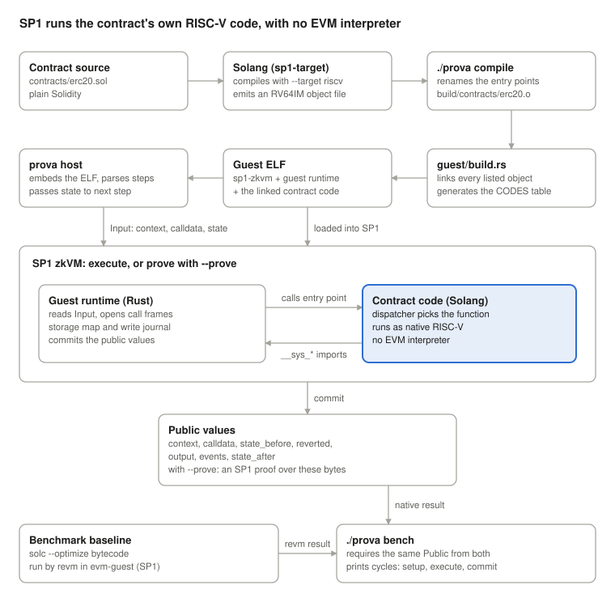

# prova: Solidity on SP1

Oct 27, 2026 · @Ahmed

prova compiles Solidity contracts to RISC-V machine code and runs them inside the SP1 zkVM, with no EVM interpreter. The work spans two repositories: a Solang compiler branch (`sp1-target`) that emits RV64IM object files, and the prova repository that links those objects into an SP1 program, runs transactions, proves them, and benchmarks them against revm.

An ERC-20 runs end to end today. On the same transactions, its execution takes 3.0 to 7.0 times fewer SP1 cycles than solc bytecode run by revm inside SP1; on pure computation the gap reaches 63 times.

## Objectives and mission

Mission: show that Solidity can be compiled directly to RISC-V and proven in a zkVM, as a working toolchain for the 2025 proposal to replace the EVM with RISC-V.

Objectives:

1. Compile Solidity with Solang to RV64IM object files that SP1 can run.
2. Define a small `__sys_*` interface that any runtime can implement.
3. Support enough Solidity to run real contracts, such as an ERC-20.
4. Prove a transaction with SP1 and show that tampering is rejected.
5. Measure the cost against solc bytecode run by revm inside SP1.

## Design goals and non-goals

Goals:

- **No interpreter:** SP1 proves the contract's own RISC-V instructions.
- **RV64IM only:** no A or C instructions, because SP1 implements RV64IM.
- **Runtime-independent:** the object uses only `__sys_*` imports, no SP1 code.
- **Ethereum-compatible:** same ABI, mapping slots, revert data and events as solc.
- **One transaction per run:** inputs and results become public values.
- **Scoped reverts:** a reverted call undoes only its own writes and events.

Non-goals (for now):

- **Proving deployed EVM contracts:** Solang output is a different program.
- **Calling EVM-only contracts:** only contracts linked into the guest.
- **Full solc storage layout:** every value takes its own slot, no packing.
- **Gas metering:** no gas yet; `docs/evm-and-gas.md` has a design.
- **Proven starting state:** the host supplies it; there is no state root yet.
- **Authenticated senders:** `msg.sender` comes from the host, unsigned.
- **ETH balances:** `msg.value` is only a number; no balance moves.

## Architecture



The Solang object is linked into the SP1 guest. The guest runtime and the contract code communicate only through the entry points and the `__sys_*` imports listed in `docs/spec.md`.

## How one transaction runs

Example, on the ERC-20:

```bash
./prova run 'deploy 1000' 'transfer(address,uint256) 0xb0b 300'
```

1. **Compile:** Solang emits `erc20.o`; entry points are renamed per contract.
2. **Build:** `guest/build.rs` links the objects and generates `CODES`.
3. **Prepare:** the host encodes the call, the context and the previous state.
4. **Execute:** the host runs the guest in SP1, one SP1 run per step.
5. **Dispatch:** the guest finds the contract at `to` and calls it.
6. **Run:** the contract calls `__sys_*` for storage, hashing, events, context.
7. **Return:** `__sys_return` or `__sys_revert` ends the frame.
8. **Commit:** the guest commits `Public`: inputs, result, events, both states.
9. **Repeat:** the host passes `state_after` into the next step.

## Current status

Everything below runs with `./prova run` and `./prova test` (11 test files, 168 steps). No proof has been generated yet: proving did not finish on a 14 GB machine, so all numbers come from SP1 execution.

Works today:

- Storage, mappings, `keccak256`, events, `msg.sender`, `msg.value`, block info.
- `string`/`bytes` in the ABI, `Error(string)` revert data, calldata checks.
- An ERC-20 with transfers, allowances, events and reverts: 31 test steps.
- Several contracts per guest: `call`, `staticcall`, `delegatecall`, try/catch.
- `./prova bench`: native and revm must give identical results on every step.

The cycle counts for every workload are in [benchmarks.md](benchmarks.md).

The speed-up is largest on pure computation and smallest on storage and division work. Most cycles per step go to committing the public values: 107,979 of 139,361 on a `transfer`.

Open issues:

- **Solang bugs:** CSE miscompiles `sort()`; a tuple swap crashes the compiler.
- **solc differences:** no struct packing; `min / -1` reverts inside `unchecked`.
- **Benchmark caveats:** `view` calls use `call`; avoid addresses `0x01`–`0x11`.
- **Missing features:** storage strings and arrays, `abi.encodePacked`, `new C()`.
- **Slow spots:** 256-bit division, double slot hashing, large public values.

## Repositories

| Repository | Role |
| --- | --- |
| [Ahmed0427/prova](https://github.com/Ahmed0427/prova) | SP1 guest, revm guest, host, tests, spec, design notes |
| [Ahmed0427/solang `sp1-target`](https://github.com/Ahmed0427/solang/tree/sp1-target) | Solang fork with the RISC-V target |
| [hyperledger-solang/solang](https://github.com/hyperledger-solang/solang) | Upstream Solang compiler the fork is based on |
| [succinctlabs/sp1](https://github.com/succinctlabs/sp1) | The zkVM: executor, prover and SDKs |
| [bluealloy/revm](https://github.com/bluealloy/revm) | EVM interpreter used as the benchmark baseline |
| [r55-eth/r55](https://github.com/r55-eth/r55) | RISC-V Ethereum runtime; uses RV64IMAC today |
